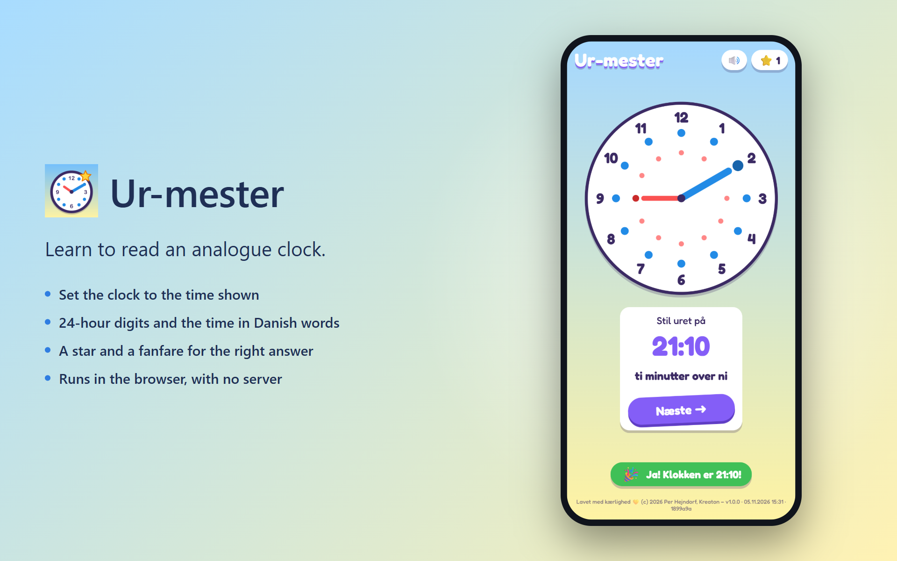

# Ur-mester (ClockMaster)




**A clock game for kids learning to read an analogue clock.**

A time is shown as digits in 24-hour format, for example **15:35**, and the child sets it on the clock face: a small red dot on the inner ring places the hour hand, a big blue dot on the outer ring places the minute hand. **Tjek** checks the clock. A right answer earns a star and a fanfare; a wrong one gets a friendly "Ups! Det er ikke rigtigt. Prøv igen!" and a sad-trombone sound, and the hands stay so they can be adjusted.

It is a Blazor WebAssembly app (.NET 10) that runs entirely in the browser, with no server or backend.

## Rules

- The hour is 00 – 23 and the minutes are always a whole five minutes. The same time never comes twice in a row.
- The clock face only has 12 hours, so 15:35 is set with the hour hand on 3, and the 12 dot means both 00 and 12.
- Under the digits the time is also written in words, chosen at random each round: the everyday way ("halv fire", "kvart i fire", "ti minutter over tre", "fem minutter i halv fire") or read off a digital clock ("femten tredive", "nul fire fyrre"). See [`Game/TimeText.cs`](src/ClockMaster/Game/TimeText.cs).
- The hour hand points straight at the chosen hour; it does not move along with the minutes.

The rules are in [`Game/ClockGame.cs`](src/ClockMaster/Game/ClockGame.cs).

## Project layout

```
ClockMaster.slnx
src/ClockMaster/
  Game/ClockGame.cs         Picks the time and checks the clock
  Game/TimeText.cs          The time in Danish words
  Pages/Home.razor          The clock face and game screen (an SVG drawn in Razor)
  Layout/MainLayout.razor
  wwwroot/
    index.html              Host page, <base href>
    css/app.css             All styling and animations
    js/sounds.js            Fanfare and try-again sounds (Web Audio API, no audio files)
    manifest.webmanifest
    icons/                  App icons and favicon
tools/make-icons.ps1        Draws the icons (and copies icon-512.png to KidsGames/billeder/clockmaster.png)
```

## Running locally

Requires the [.NET 10 SDK](https://dotnet.microsoft.com/download).

```bash
dotnet run --project src/ClockMaster
```

Then open http://localhost:5318 (or https://localhost:7318 with the `https` launch profile).

## Publishing

Pushing to `main` builds the app and puts it in the `clockmaster/` folder of the KidsGames GitHub Pages site (<https://kreaton.github.io/KidsGames/clockmaster/>) with [`.github/workflows/deploy.yml`](.github/workflows/deploy.yml). It needs the repository secret `PAGES_DEPLOY_KEY`.

To publish by hand:

```bash
dotnet publish src/ClockMaster -c Release -o src/ClockMaster/bin/Publish
```

and copy the contents of `bin/Publish/wwwroot` to any static web host.

The app is set up to be served from a `clockmaster` sub-path: `<base href>` in [`wwwroot/index.html`](src/ClockMaster/wwwroot/index.html) is `clockmaster`. Change it if you host the app somewhere else, for example `/` for the site root.
